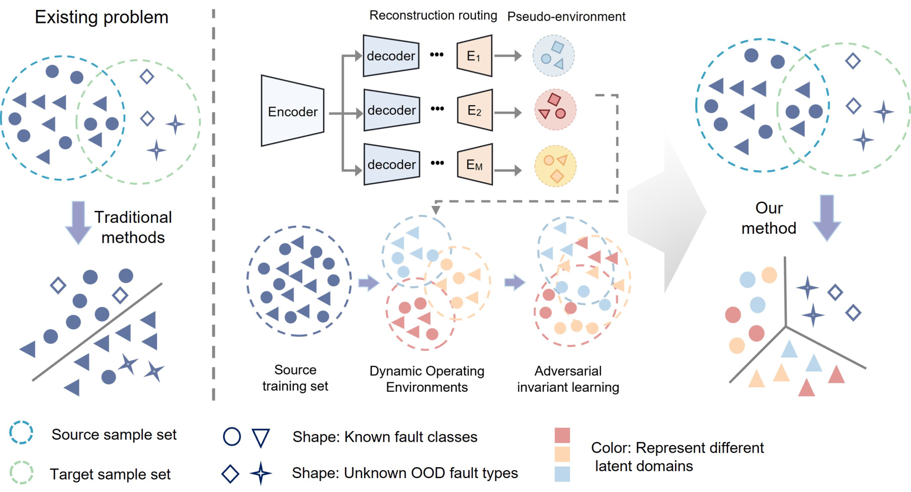
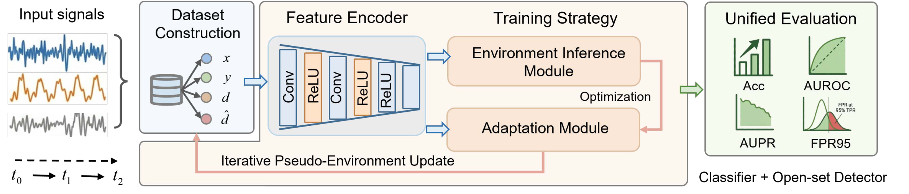
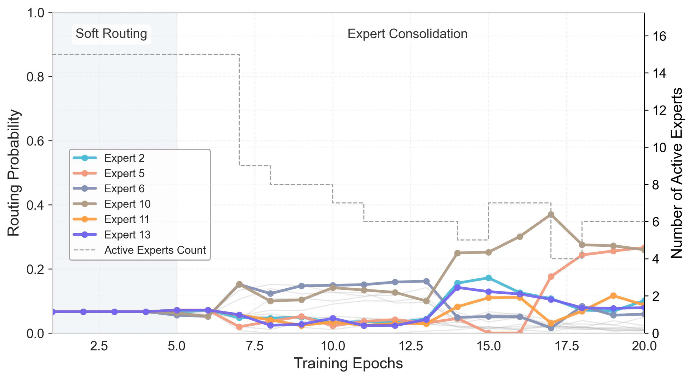
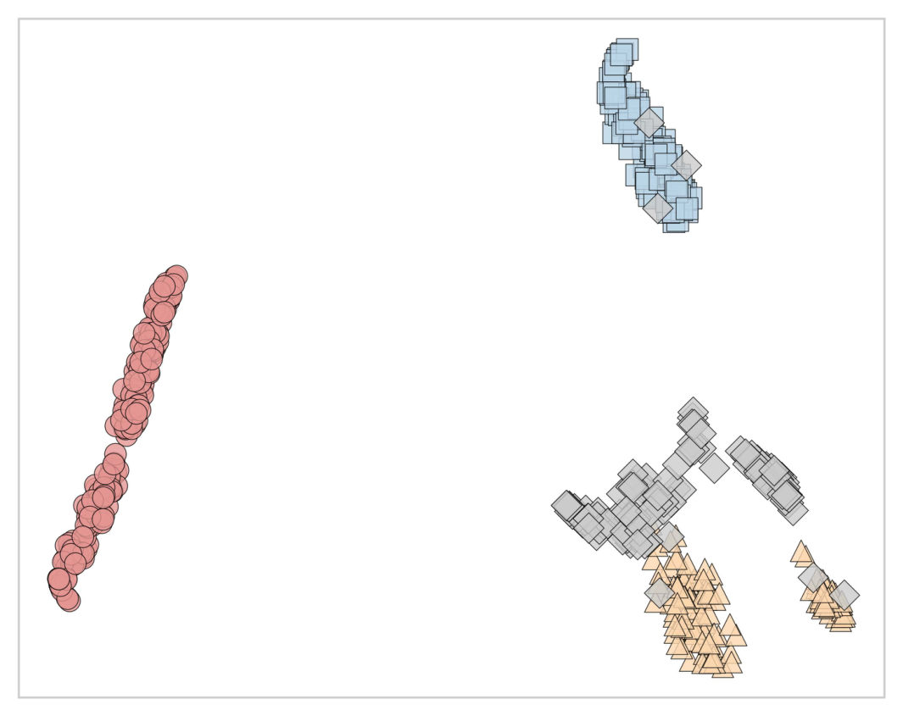

<div align="center">

# AERO: Adaptive Environment Routing for Open-Set Fault Diagnosis Under Latent Domain Shifts

[](https://www.python.org/)
[](https://pytorch.org/)
[](LICENSE)
[](#citation)

**Bowen Yu**<sup>1</sup>, **Donghai Han**<sup>1,\*</sup>, **Zhonglei Shen**<sup>1</sup>, **Zhibin Zhao**<sup>1</sup>, **Wenxian Yang**<sup>2</sup>, **Liuyang Zhang**<sup>1,\*</sup>, **Ruqiang Yan**<sup>1</sup>, **Xuefeng Chen**<sup>1</sup>

<sup>1</sup> *School of Mechanical Engineering, Xi'an Jiaotong University, Xi'an 710049, China*  
<sup>2</sup> *School of Computing and Engineering, University of Huddersfield, Huddersfield HD1 3DH, UK*

</div>

---

## Overview

Industrial rotating machinery operates under time-varying speeds, loads, and acquisition conditions, while previously unseen fault modes can emerge unexpectedly during deployment. Most existing methods treat distribution shift and open-set recognition separately, or rely on rigid offline pseudo-environment clustering that becomes unstable when explicit domain labels are unavailable.

**AERO (Adaptive Environment Routing Optimization)** is a training-time framework for **open-set fault diagnosis (OSFD) under latent domain shifts** without environment annotations. AERO closes the loop between latent-structure discovery and invariant representation learning through three coupled mechanisms:

1. **Reconstruction-Based Environment Routing**: Multiple parallel expert decoders reconstruct input vibration signals from shared latent representations; sample-wise reconstruction errors dynamically yield soft/hard routing assignments as pseudo-domain evidence.
2. **Schedule-Assisted Expert Consolidation**: Starting from an over-parameterized expert pool ($M_{\max}$), AERO progressively prunes redundant experts toward a compact, stable latent environment structure.
3. **Confidence-Weighted Adversarial Invariant Learning**: A Gradient Reversal Layer (GRL) aligns features across the inferred pseudo-environments while confidence weighting down-weights noisy or class-entangled assignments.

> **Zero Deployment Overhead:** All routing decoders and the domain discriminator are discarded after training. The deployed model retains the exact inference pathway, parameter count, and FLOPs of a standard encoder–classifier backbone.

<p align="center">
  
  <br>
  <em>Figure 1: Open-set fault diagnosis under latent environment shifts without training-time domain annotations.</em>
</p>

---

## Method Architecture

<p align="center">
  
  <br>
  <em>Figure 2: Overall architecture of the proposed AERO training-time framework.</em>
</p>

---

## Representative Qualitative & Mechanism Highlights

> *Note: This repository provides the core implementation and representative figures from the manuscript. Complete experimental logs, raw checkpoints, and full supplementary tables are excluded for clarity and conciseness.*

<p align="center">
  
  <br>
  <em>Figure 3: Progressive expert routing and consolidation dynamics during training, pruning redundant experts into a compact core structure.</em>
</p>

<p align="center">
  
  <br>
  <em>Figure 4: Representative t-SNE feature visualization under cross-domain open-set testing, showing compact known-class clusters and clear separation from unknown faults.</em>
</p>

---

## Repository Structure

```text
AERO/
├── assets/                                  # Selected manuscript figures
├── algorithms/
│   ├── route1_algorithm.py                  # Core AERO alternating optimization & OOD scoring
│   └── baseline_methods.py                  # Representative DG / OSFD baseline algorithms
├── models/
│   ├── routing_model.py                     # Shared encoder, multi-expert decoders, router & GRL
│   └── baseline_model.py                    # Backbone and baseline architectures
├── datasets/
│   ├── base_dataset.py                      # Base dataset & sliding-window utilities
│   ├── builder.py                           # Unified cross-domain / cross-dataset loader builder
│   ├── cwru_jnu.py                          # CWRU and JNU bearing dataset loaders
│   └── self_npz.py                          # Custom physical testbed (.npz) loader
├── utils/
│   ├── common.py                            # Seeding and path utilities
│   ├── metrics.py                           # KnownAcc, AUROC, AUPR, FPR95 metrics
│   └── visualization.py                     # Diagnostic plots (collapse curves, OOD histograms)
├── scripts/
│   ├── compare_ood_scores_from_checkpoints.py  # Post-hoc MSP / Energy / MaxLogit evaluation
│   └── profile_model_efficiency.py          # Parameter, FLOPs, and inference latency profiling
├── config.py                                # Centralized hyperparameters & ablation flags
├── train.py                                 # AERO training entrypoint
├── test.py                                  # AERO evaluation entrypoint
├── train_baseline.py                        # Baseline training entrypoint
├── test_baseline.py                         # Baseline evaluation entrypoint
├── run_scenario_benchmark.py                # Cross-domain (Setting B) & Cross-dataset (Setting C) runner
├── run_ablation_benchmark.py                # Structural, training & equal-capacity ablation runner
└── requirements.txt
```

---

## Quick Start

### 1. Environment Setup

```bash
git clone https://github.com/ybw110/AERO.git
cd AERO
python -m venv .venv
source .venv/bin/activate        # On Windows: .\.venv\Scripts\Activate.ps1
pip install -r requirements.txt
```

### 2. Data Preparation

Organize public bearing datasets under `data/` (configurable in `config.py`):

```text
data/
├── CWRU/                        # Case Western Reserve University bearing dataset (.mat)
└── JNU/                         # Jiangnan University bearing dataset (.csv)
```

For custom physical testbed datasets, pass `--self_processed_root /path/to/Processed_Data_Numpy` containing `SelfA/` and `SelfB/`.

### 3. Training & Evaluation

**Train AERO (Single Run):**

```bash
python train.py \
  --dataset CWRU \
  --domains 0HP,1HP,2HP \
  --known_classes 0,1,3 \
  --unknown_classes 2 \
  --epochs 30 \
  --batch_size 64 \
  --m_max 15 \
  --seed 42
```

**Evaluate on Unseen Target Domain / Dataset:**

```bash
python test.py \
  --ckpt outputs/<run_dir>/best_model.pt \
  --dataset_override CWRU \
  --domains_override 3HP
```

**Run Cross-Domain (Setting B) or Cross-Dataset (Setting C) Benchmark:**

```bash
python run_scenario_benchmark.py \
  --scenario B_CROSS_DOMAIN \
  --dataset CWRU \
  --domains 0HP,1HP,2HP,3HP \
  --known_classes 0,1,3 \
  --unknown_classes 2 \
  --methods ROUTE1,ERM,DIVERSIFY,AMINET,DACN,AFRDN,WPA_PDG \
  --seed 42
```

**Run Ablation Study (including Equal-Capacity Control `EQCAP_NO_ENV`):**

```bash
python run_ablation_benchmark.py \
  --scenario B_AND_C \
  --dataset CWRU --domains 0HP,1HP,2HP,3HP \
  --train_dataset CWRU --train_domains 0HP,1HP,2HP,3HP \
  --test_dataset JNU --test_domains 600,800,1000 \
  --known_classes 0,1,3 --unknown_classes 2 \
  --variants FULL,EQCAP_NO_ENV \
  --seeds 41,42,43
```

---

## Citation

If you find this repository helpful in your research, please consider citing our work:

```bibtex
@article{yu2026aero,
  title   = {AERO: Adaptive Environment Routing for Open-Set Fault Diagnosis Under Latent Domain Shifts},
  author  = {Yu, Bowen and Han, Donghai and Shen, Zhonglei and Zhao, Zhibin and Yang, Wenxian and Zhang, Liuyang and Yan, Ruqiang and Chen, Xuefeng},
  journal = {Mechanical Systems and Signal Processing},
  year    = {2026}
}
```

## License

This project is released under the [MIT License](LICENSE).
